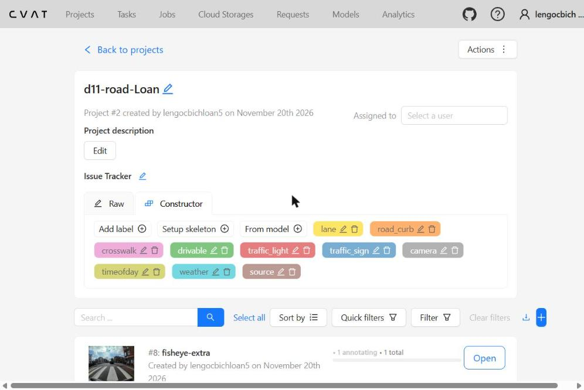
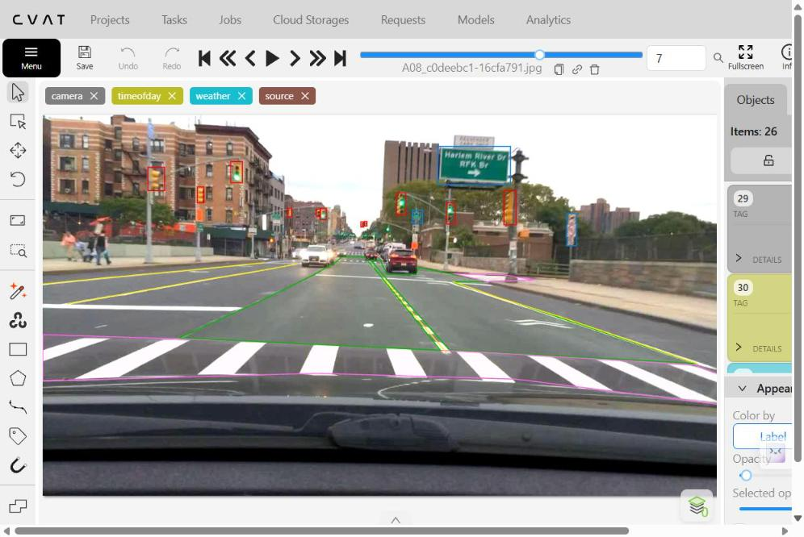
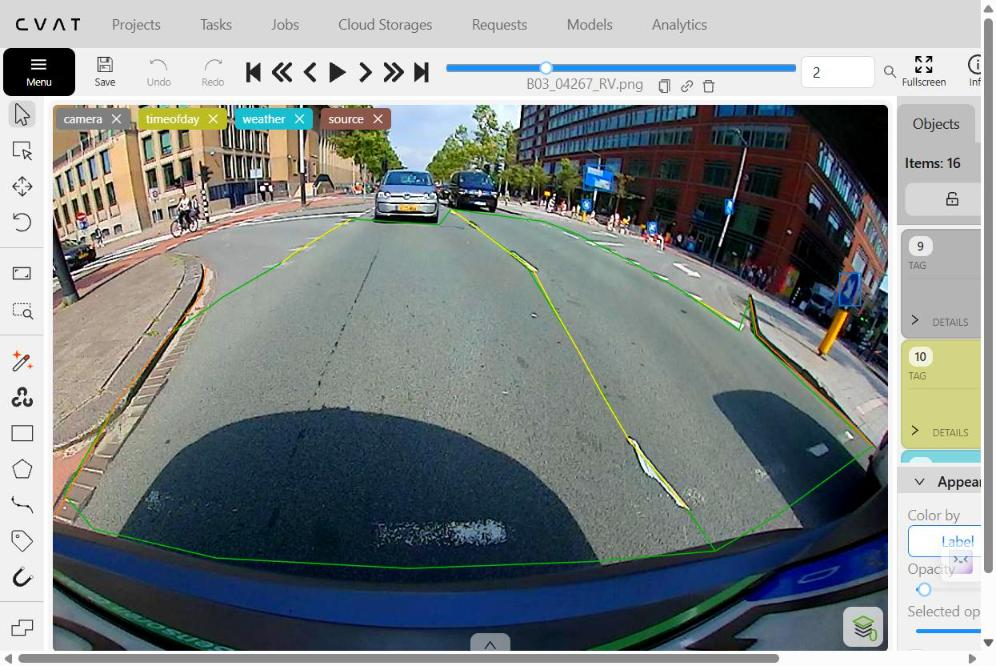
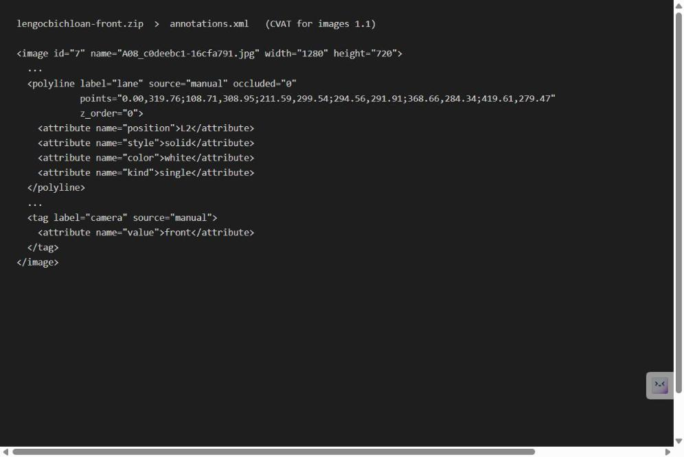

# Báo cáo cá nhân — Ngày 11
Họ tên: Lê Ngọc Bích Loan      Mã học viên: 2A202603070  
Phiên bản CVAT (Help → About): 2.81.0 (CVAT chạy local, project `d11-road-Loan`)  
Guideline: Road v1.0    Lần nộp (`revision` trong manifest): 2  
Thời điểm export (ngày giờ trên CVAT): 21/11/2026 khoảng 23:59 (bản revision 2)    Số lần nộp lại sau Rework: 1 

## 1. Kiểm project
| Mục | Đúng như guideline Road v1.0? | Ghi chú |
| --- | --- | --- |
| 6 label, đúng kiểu | Có | lane, road_curb (polyline); crosswalk, drivable (polygon); traffic_light, traffic_sign (rectangle) |
| Thuộc tính và giá trị | Có | lane: position/style/color/kind; drivable: area_type; đèn: color/type/facing/edge_zone; biển: group/facing/edge_zone. Giá trị mặc định CVAT là giá trị đầu danh sách nên đã sửa từng nhãn |
| 4 tag ảnh | Có | camera, timeofday, weather, source; mỗi tag là label kiểu Tag có một thuộc tính select `value` |
Cách kết thúc polyline trên bản CVAT này: bấm phím **N** sau điểm cuối.  
Cách đặt tag ảnh trên bản CVAT này: công cụ **Tag** ở thanh bên trái, chọn label (camera trước tiên), rồi mở **Details** trong bảng Objects để sửa `value`.

## 2. Số lượng đã gán
| Task | Ảnh | lane | road_curb | crosswalk | drivable | traffic_light | traffic_sign |
| --- | ---: | ---: | ---: | ---: | ---: | ---: | ---: |
| front | 12 | 30 | 6 | 4 | 24 | 32 | 19 |
| front-extra (đã làm 0 / 4) | 0 | — | — | — | — | — | — |
| fisheye | 8 | 9 | 7 | 7 | 9 | 7 | 6 |
| fisheye-extra (đã làm 0 / 4) | 0 | — | — | — | — | — | — |

(Số liệu lấy từ `lengocbichloan-manifest.json`, revision 2.)

## 3. Bảng ca khó
| Ảnh | Nhãn | Phân vân giữa | Đã chọn | Lý do |
| --- | --- | --- | --- | --- |
| A05 | lane L1/R1 | Vẽ vạch hay không | Không vẽ lane; vẽ `road_curb` bên phải và `drivable direct` | Đường không có vạch sơn; `direct` không gồm dải xe đỗ hai bên (guideline mục 3). Chờ coach xác nhận miễn QC1-02 |
| A06 | crosswalk | Vạch ngựa vằn hay vạch kéo dài làn qua giao lộ | `crosswalk` (một polygon) | Hàng vạch nằm ngang đường, cách đều, ở đầu giao lộ |
| A06 | traffic_light (đèn đi bộ) | Màu `green` hay `unknown` khi hiện hình người trắng | `green`, `type = pedestrian` | Tín hiệu cho phép đi; thang màu không có giá trị "trắng" |
| A06 | lane L1 | Có L1 không | Không vẽ L1 | Không thấy vạch trái trong làn gần xe; chờ lead (ca mơ hồ trong phiếu QC) |
| A07 | lane L1 | Vệt sáng mờ dọc dải phân cách là vạch sơn hay vệt bẩn | Bản 1: không vẽ; bản 2: vẽ L1 trắng liền | Người kiểm xác nhận thấy vạch; tăng tương phản thì thấy vệt liên tục, song song chân dải phân cách |
| A09 | lane R1 | R1 thấy được không | Không vẽ R1 | Bên phải chỉ có vỉa hè và vạch chéo; chờ lead |
| A10 | lane R1 | Nối qua đoạn bị che hay dừng | Nối liền, bật `occluded` | Đoạn vạch bị con thú bông trên taplo che ngắn |
| B03, B04 | lane position | L/R theo phía ảnh hay theo phía xe ở camera sau | Theo phía ảnh (vạch bên trái ảnh là L) | Guideline không nói rõ cho fisheye_rear; cần hỏi lead |
| B03 | lane R1 | Nối vệt sơn sát xe với vạch đứt ở xa | Một polyline R1, 10 điểm theo cung | Vạch đứt là một polyline; đoạn giữa không thấy sơn |

## 4. Phiếu QC 1 nhận được
Bạn kiểm lô của tôi: Nguyễn Duy Khánh (`nguyenduykhanh`)  Quyết định nhận được: **Rework** (2 lỗi nặng; lỗi chính 2/68 = 2,9 %)  
| Mã lỗi | Số lỗi | Đồng ý? | Đã sửa? |
| --- | ---: | --- | --- |
| QC1-02 (A07 thiếu L1, A06 thiếu R1) | 2 | Đồng ý | Đã sửa: thêm L1 ở A07; thêm R1 ở A06. Riêng đoạn (860–910, 474–490) người kiểm tính vào R1 A06 nằm trong vùng vạch ngựa vằn nên tôi không nối R1 qua đó, R1 dừng ở điểm xa nhất còn thấy vạch (1127,547) |
| QC1-07 (A07 drivable khoét quanh xe) | 1 | Đồng ý | Đã sửa: vẽ lại `direct` liền khối, cạnh trái theo L1 mới |
| QC1-04 (B03 R1 không tới sát xe) | 1 | Đồng ý | Đã sửa: R1 bắt đầu tại (957,631), 10 điểm |
| QC1-12 (tên file zip) | 1 | Đồng ý | Đã sửa: `lengocbichloan-front.zip`, `lengocbichloan-fisheye.zip` |
| QC1-11 (lint: 3 polyline fisheye chỉ 3 điểm, ca mơ hồ) | 0 | — | Vẫn sửa: thêm điểm theo cung cho L1 ở B03 và lane ở B07 |

Bản sửa nộp lại là **revision 2**. Bản gốc (hai zip và `lengocbichloan-manifest-r1.json`) giữ trong thư mục `r1/`. Lint bản 2 còn 4 cảnh báo QC1-02 ở A05 (L1, R1), A06 (L1), A09 (R1): đây là ảnh không thấy vạch hoặc ca đang chờ lead, cần coach xác nhận miễn.

## 5. Kiểm file export
| File | Mở lại được? | Số shape ảnh 1 (job / file) | Số shape ảnh 2 (job / file) | Tag camera có trong XML? |
| --- | --- | --- | --- | --- |
| lengocbichloan-front.zip | Có (`road_check lint`, CVAT for images 1.1) | A01: 11 / 11 | A02: 8 / 8 | Có (`front`) |
| lengocbichloan-fisheye.zip | Có | B01: 2 / 2 | B02: 9 / 9 | Có (`fisheye_front`) |

`contains_images` = false cho cả hai file (manifest revision 2).

## 6. Ảnh chụp màn hình
1. Tab Labels của project `d11-road-Loan`: 6 label vẽ (lane, road_curb, crosswalk, drivable, traffic_light, traffic_sign) và 4 label tag (camera, timeofday, weather, source).

   

2. Ảnh camera trước A08 đã gán đủ: 4 tag; lane L2, L1, R1 (đứt), R2; 2 crosswalk; drivable `direct` và `alternative`; 11 traffic_light và 3 traffic_sign (22 shape + 4 tag = 26 đối tượng).

   

3. Ảnh fisheye B03 (`fisheye_rear`), phóng to: R1 và R2 vạch đứt đi theo cung, R1 có 10 điểm, bắt đầu sát xe; road_curb theo mép đảo giao thông; thân xe không gán.

   

4. Đoạn `annotations.xml` trong `lengocbichloan-front.zip` có `<polyline label="lane">` (ảnh A08, L2) kèm 4 thuộc tính và tag camera.

   

## 7. Tự đánh giá
Lỗi bạn mắc nhiều nhất hôm nay (theo mã QC1-xx), và cách tránh ở Ngày 20: QC1-02 (bỏ sót L1/R1 khi vạch mờ) và QC1-07 (vùng lái khoét quanh xe). Ở Ngày 20 (ca mưa, đêm, vạch mờ hơn) tôi sẽ tăng tương phản khi xem ảnh trước khi kết luận "không thấy vạch", và kiểm lại mọi polygon `drivable` theo quy tắc "đi được nếu đường trống" trước khi Save. Ngoài ra chỉ mở một tab CVAT cho mỗi job, vì một tab cũ đã lưu đè làm mất phần sửa.  
Nhãn của bạn đi vào model ở đâu? Chọn một lỗi đã sửa và nói nó làm model học sai thế nào: polyline `lane` đi vào model phát hiện làn (row-anchor) làm đích x theo từng hàng; polygon `drivable` đi vào model phân đoạn vùng lái. Lỗi A07 thiếu L1: model học rằng vệt sơn mờ cạnh dải phân cách không phải vạch làn, nên khi vạch phai model không đưa ra biên trái của làn, LKA không giữ được xe trong làn đúng lúc cần nhất. Lỗi khoét lỗ quanh xe: model học rằng mặt đường dưới xe phía trước là "không đi được", làm vùng lái co lại theo xe khác thay vì theo cấu trúc đường.

## 8. (Tùy chọn, buffer) Từ polyline đến đích row-anchor
Ảnh A01, vạch R1 (vạch trắng đứt bên phải làn đang đi). Số tính bằng `python -m road_lab.rowanchor <file>.zip --image A01 --position R1` trên hai file nộp revision hiện tại.

| y | 720 | 680 | 640 | 600 | 560 |
| --- | ---: | ---: | ---: | ---: | ---: |
| x của chúng tôi | không có làn | không có làn | 602,2 | 543,7 | 483,6 |
| x của bạn kia (Nguyễn Duy Khánh) | không có làn | không có làn | 603,0 | 544,8 | 486,6 |

R1 của tôi đi từ (654,677) gần xe tới (459,542) ở xa; của bạn kia bắt đầu tại (652,674). Cả hai đều bắt đầu dưới hàng 680, vì đoạn sát đáy ảnh không có vệt sơn, nên hàng 720 và 680 là "không có làn".

Trả lời 3 câu:

1. Nếu dừng polyline sớm 40 px, điểm xa nhất lùi từ y = 542 xuống khoảng y = 582. Hàng **560** khi đó nằm ngoài polyline nên đổi thành "không có làn"; các hàng 640 và 600 giữ nguyên. Model sẽ học rằng ở hàng 560 không có vạch, tức là "nhìn" làn ngắn hơn thực tế.
2. Hàng 720: cả hai đều "không có làn", lệch 0 px. Hàng 560: lệch 486,6 − 483,6 = **3,0 px**; hàng 640 chỉ lệch 0,8 px. Lệch ở các hàng gần xe (720, 680, 640) ảnh hưởng LKA nhiều hơn: LKA tính độ lệch ngang của xe so với tâm làn ngay phía trước. Vài pixel ở hàng gần tương ứng một khoảng ngang lớn hơn trên mặt đường so với vài pixel ở hàng xa, và sai ở đó làm lệnh đánh lái sai ngay lập tức.
3. Không đổi về số: `x_at_y` trong `geometry.py` lấy giao điểm của polyline với từng hàng y, không phụ thuộc điểm nào vẽ trước. Chỉ khi polyline không đơn điệu theo y (cong ngược, gấp khúc) thì thứ tự điểm mới đổi kết quả, vì hàm trả về đoạn cắt đầu tiên tìm thấy. Script gặp khó là `road_check`: `lint` cảnh báo polyline vẽ từ xa về gần, và `check` bắt lỗi QC1-04 vì điểm đầu phải là điểm gần xe nhất. Điểm đầu sai cũng làm hỏng việc so hai đầu polyline với GT (ngưỡng `lane_stop_px`).
